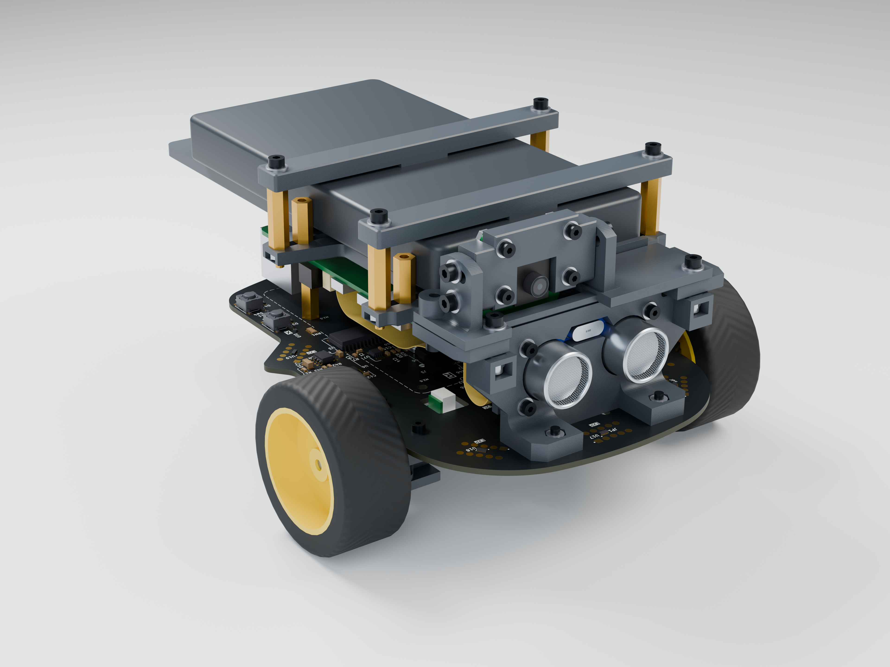
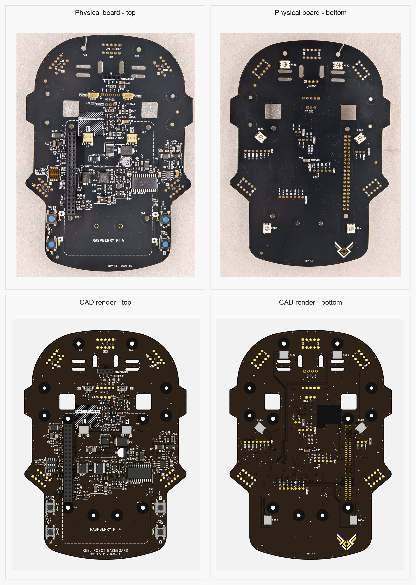
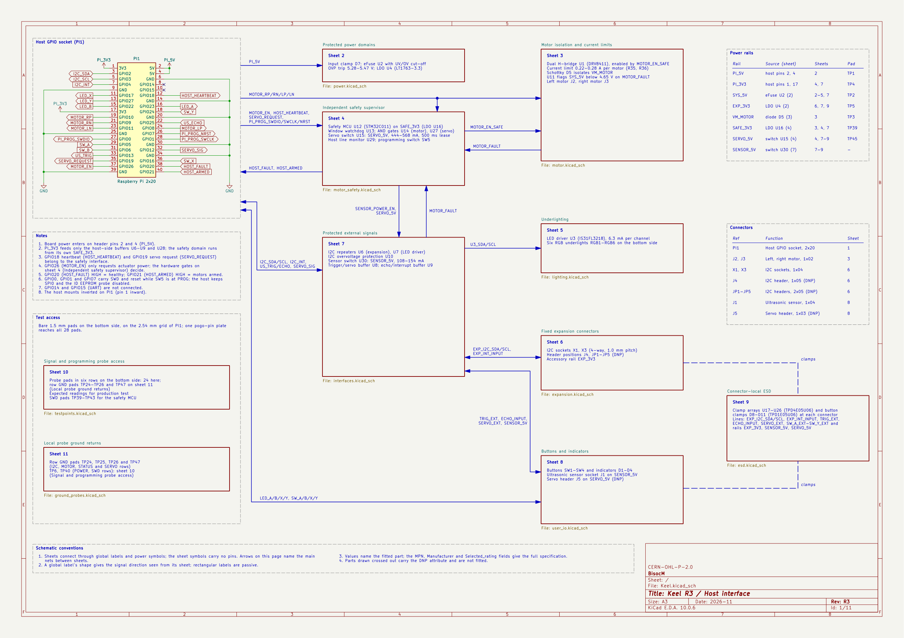
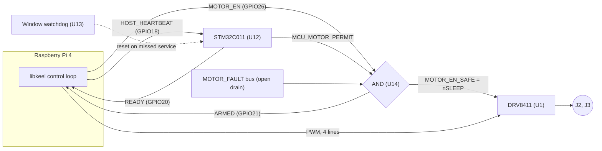
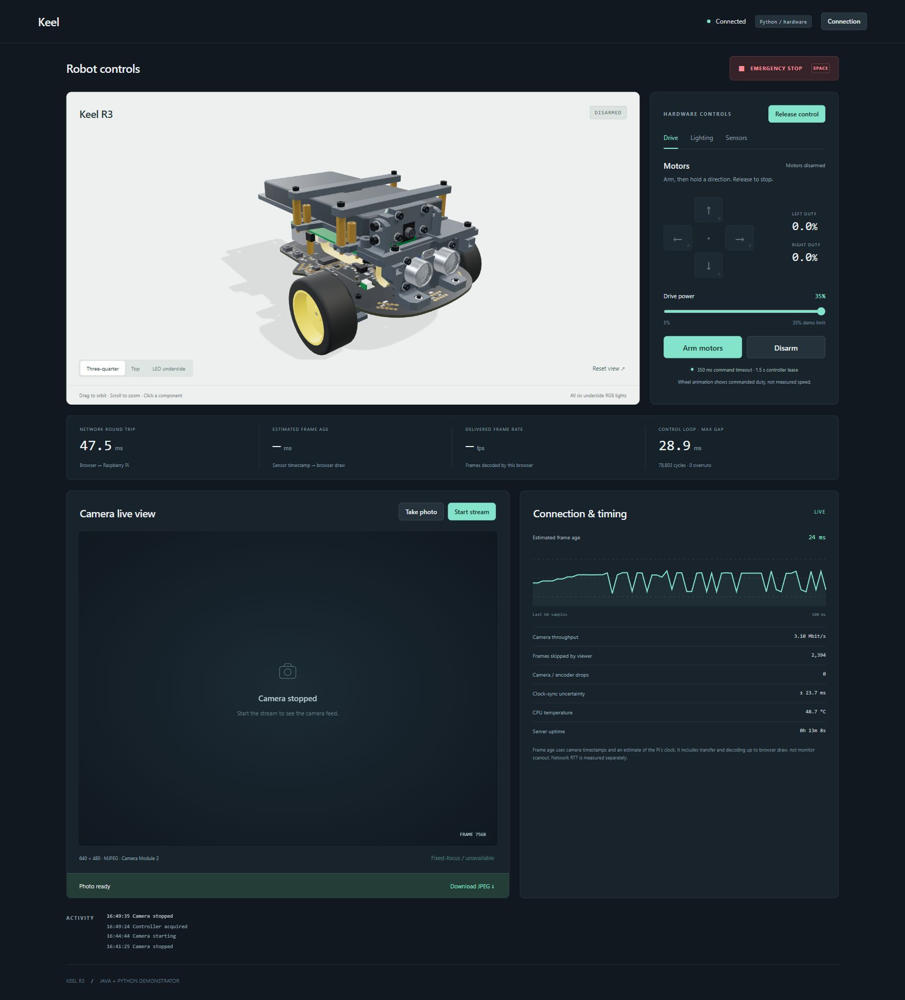
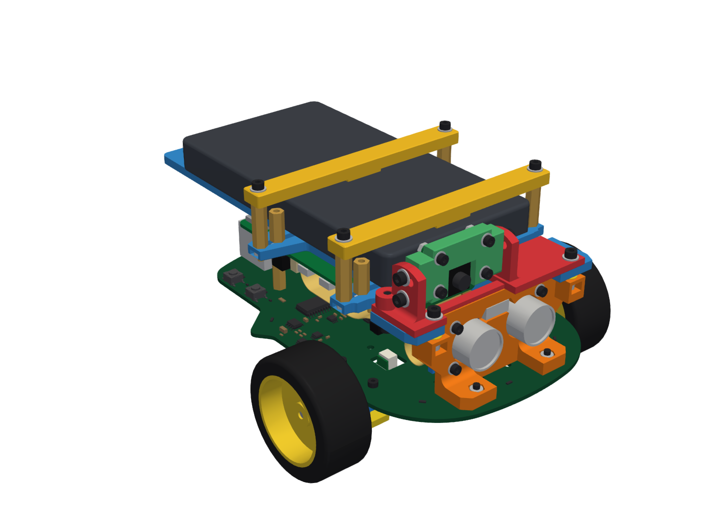

# Keel

[](https://github.com/BisocMOrg/Keel/actions/workflows/libkeel.yml)
[](https://github.com/BisocMOrg/Keel/actions/workflows/bindings-python.yml)
[](https://github.com/BisocMOrg/Keel/actions/workflows/bindings-java.yml)
[](https://github.com/BisocMOrg/Keel/actions/workflows/firmware.yml)

Keel is a Raspberry Pi 4 robot baseboard with two DC motor channels, an ultrasonic sensor interface, six RGB LEDs, four illuminated buttons and I²C expansion. The Pi mounts inverted through a 40-pin socket. A hardware AND gate enables the motors only when the host requests it, the STM32C011 controller grants permission and the fault bus is clear.

The repository contains the R3 hardware design, STM32 firmware, C libraries for board control (libkeel) and camera operation (libkeel-camera), Python and Java bindings, and a 3D-printable chassis.

The R3 board has been manufactured, assembled and tested on hardware. The [verification results](#verification)
cover motor drive, the safety chain, LEDs, buttons and camera operation.

<p align="center">
  <br>
  <sub>Robot chassis design (render).</sub>
</p>

## Contents

- [Hardware](#hardware)
- [Motor enable chain](#motor-enable-chain)
- [Software](#software)
- [Demonstrators](#demonstrators)
- [Camera](#camera)
- [Robot chassis](#robot-chassis)
- [Building and installing](#building-and-installing)
- [Verification](#verification)
- [Repository layout](#repository-layout)
- [Documentation](#documentation)
- [Licences](#licences)

## Hardware

| Parameter | Value |
|---|---|
| Revision | R3 (2026-11) |
| Board | 106 x 150 mm, 6 layers, 1.6 mm, KiCad 10 |
| Host | Raspberry Pi 4, mounted upside down on a 2x20 socket (PI1) with a booster header, about 19.5 mm stack height |
| Supply | 5 V from host header pins 2 and 4, through a TVS clamp (D7) and an eFuse (U2, TPS259474L) with under- and over-voltage cut-off; over-voltage trip 5.28-5.47 V |
| Motor driver | DRV8411 dual H-bridge (U1), four host PWM lines, current regulation through 0.82 Ohm sense resistors: 0.22-0.28 A per motor |
| Motor connectors | J2 (left), J3 (right): 2-pin 1.5 mm side entry |
| Safety controller | STM32C011F4P6 (U12) on its own 3.3 V rail (U16), window watchdog TPS3436 (U13), 3-input AND gates for the motor (U14) and servo (U27) enables |
| Ultrasonic socket | J1, 4-pin 2.54 mm (5 V, TRIG, ECHO, GND) for an HC-SR04; 5 V switched by U30 (TPS2553-1), 108-154 mA limit; open-drain trigger buffer and echo buffer |
| Servo header | J5, not fitted on R3; 5 V switched by U15 (TPS2553-1), 444-568 mA limit, timed bursts only |
| LEDs | Six RGB LEDs on the bottom side, IS31FL3218 driver (U3) at I2C address 0x54, up to 6.3 mA per channel; four white LEDs at the buttons on host GPIOs |
| Buttons | SW1-SW4 (A, B, X, Y), active low on host GPIOs |
| Expansion | I2C through a repeater (U6) and an over-voltage protector (U10): two 4-pin 1.0 mm sockets (X1, X3) on a 3.3 V accessory rail (U4, LT1763), plus six unfitted header positions (J4, JP1-JP5) |
| ESD | Clamp arrays at every external connector and the buttons |
| Test access | 28 bare pads on the bottom side on a 2.54 mm grid |
| Programming | SW5 (4-pole DIP): all ON = programming (host GPIO0/1/7 connect to the controller's SWD and reset), all OFF = normal operation |

<p align="center">
  <a href="hardware/physical/Keel_R3_physical_and_renders.jpg"></a><br>
  <sub>Physical R3 board (top row) and CAD renders (bottom row); top side left, bottom side right.</sub>
</p>

### Connections

| Device | Connects to | Path |
|---|---|---|
| Raspberry Pi 4 | PI1, through a 2x20 booster header | Keel takes its 5 V from the Pi's header pins 2 and 4 and uses the GPIO lines listed below |
| Two DC gearmotors | J2 (left), J3 (right) | U1, behind the motor enable gate |
| HC-SR04 ultrasonic sensor | J1, near the front | 5 V switched and current-limited by U30; TRIG and ECHO buffered to GPIO13 and GPIO25 |
| I2C accessories | X1, X3 (pin 1 GND, pin 2 3.3 V, pin 3 SDA, pin 4 SCL) | U6 repeater and U10 over-voltage protector on I2C1 |
| Raspberry Pi Camera Module 2 or 3 | The Pi's own camera connector, with a 15-way 1.0 mm flat cable | Not through Keel |
| Power source, 5 V / 3 A | The Pi's USB-C input (the chassis uses a USB-C power bank) | Not through Keel: the board and the motors run from the Pi's 5 V |

Keel has no connection to the Pi's camera and display connectors, USB, Ethernet or HDMI, or to GPIO14 and GPIO15
(UART).

### Host GPIO assignment

| BCM | Header pin | Signal | Direction (host) | Function |
|---|---|---|---|---|
| 2, 3 | 3, 5 | I2C_SDA, I2C_SCL | bidirectional | I2C1: LED driver and expansion bus |
| 4 | 7 | I2C_INT | input | Expansion interrupt (buffered, active low) |
| 8, 11 | 24, 23 | MOTOR_LP, MOTOR_LN | output | Left motor PWM |
| 10, 9 | 19, 21 | MOTOR_RP, MOTOR_RN | output | Right motor PWM |
| 26 | 37 | MOTOR_EN | output | Motor enable request (AND gate input; also the arming handshake) |
| 18 | 12 | HOST_HEARTBEAT | output | Heartbeat to the safety controller |
| 19 | 35 | SERVO_REQUEST | output | Servo power request |
| 12 | 32 | SERVO_SIG | output | Servo signal |
| 20 | 38 | HOST_FAULT | input | READY: high while the safety controller is healthy |
| 21 | 40 | HOST_ARMED | input | ARMED: high while the motor driver is enabled |
| 13 | 33 | US_TRIG | output | Ultrasonic trigger |
| 25 | 22 | US_ECHO | input | Ultrasonic echo |
| 5, 6, 16, 24 | 29, 31, 36, 18 | SW_A, SW_B, SW_X, SW_Y | input | Buttons, active low |
| 23, 22, 17, 27 | 16, 15, 11, 13 | LED_A, LED_B, LED_X, LED_Y | output | Button LEDs |
| 0, 1, 7 | 27, 28, 26 | PI_PROG_SWDIO, PI_PROG_SWCLK, PI_PROG_NRST | - | Controller programming, connected only while SW5 is ON |
| 14, 15 | 8, 10 | - | - | Not connected |

<p align="center">
  <a href="hardware/schematic/Keel_R3_schematic.pdf"></a><br>
  <sub>Schematic sheet 1 of 11 (host socket and block diagram). The full schematic is <a href="hardware/schematic/Keel_R3_schematic.pdf">Keel_R3_schematic.pdf</a>.</sub>
</p>

## Motor enable chain



- `nSLEEP = MOTOR_EN AND MCU_MOTOR_PERMIT AND MOTOR_FAULT`. The servo switch enable is built the same way (U27) with
  the controller's servo permit.
- The controller raises `MCU_MOTOR_PERMIT` only after an arming sequence on `MOTOR_EN` with a heartbeat inside its
  timing window, and lowers it on a missed heartbeat, a PWM edge outside the permitted states, or any latched fault.
  After a fault the host must repeat the arming sequence.
- `MOTOR_FAULT` is an open-drain bus with a 22 kOhm pull-up. It is pulled low by the 5 V supervisor (U11, below
  4.65 V), the watchdog output (U13) and the sensor and servo switches (U30, U15). A low bus disables both enables and
  resets the controller. The controller cannot drive the bus.
- U1's own nFAULT output (pin 8) is not connected: on the bus it would gate U1's own nSLEEP during its wake-up pulse.
  The DRV8411 still protects itself (over-current, thermal shutdown, under-voltage lockout).
- The disable path contains no firmware: the host or the fault bus can remove motor power alone.

Measured on hardware: `ARMED` falls 9-37 us after a host stop command, and 51-71 ms after the host process is killed
(heartbeat stops; design bound about 86 ms after the last heartbeat edge). The full host and controller contract is in
[`firmware/safety-mcu/docs/mcu_integration.md`](firmware/safety-mcu/docs/mcu_integration.md).

The board is an engineering safety interlock, not a certified safety device.

## Software

| Component | Description |
|---|---|
| [`software/libkeel`](software/libkeel/README.md) | C11 host library for the board, ABI 1.0, `libkeel.so.1`, header `keel/keel.h`. Backends: `r3` (GPIO character device, i2c-dev, real-time PWM thread) and `simulator` (steps an unmodified copy of the controller's policy code). |
| [libkeel-camera](software/libkeel/docs/camera.md) | C camera library, ABI 1.0, `libkeel-camera.so.1`, header `keel/camera.h`, in the libkeel source tree (`software/libkeel/src/camera`). See [Camera](#camera). |
| Tools | `keel-doctor` (checks device access, GPIO lines, real-time limits, I2C), `keel-live` (hardware test modes), `keel-demo`, `keel-setup` (groups and boot configuration), all in `keel-tools`; `keel-camera` (camera list, stills, recording, streaming, raw frames) in its own package. |
| Debian packages | Board: `libkeel1`, `libkeel-dev`, `keel-common`, `keel-tools`. Camera: `libkeel-camera1`, `libkeel-camera-dev`, `keel-camera`. Python binding: `python3-keel`. The board packages do not depend on the camera packages. |
| [`software/bindings/python`](software/bindings/python/README.md) | Python 3.11+ binding over ctypes, distribution `keel-robot`, import name `keel`. Packages `keel.errors`, `keel.loop`, `keel.state`, `keel.peripherals`, `keel.sim`, and `keel.camera` for the camera; `keel` re-exports every board name. |
| [`software/bindings/java`](software/bindings/java/README.md) | Java 25+ binding over the Foreign Function and Memory API, `io.github.bisocmorg:keel`, module `io.github.bisocmorg.keel`. Packages `io.github.bisocmorg.keel` and its subpackages `errors`, `loop`, `state`, `peripherals`, `sim`, and `camera` for the camera; no native code. |
| [Java and Python demonstrators](software/demonstrator/README.md) | Two independent Pi servers with a shared local browser dashboard: interactive 3D robot, LEDs, hold-to-drive motors, ultrasonic ranging, camera streaming/photos and measured timing statistics. |
| [`firmware/safety-mcu`](firmware/safety-mcu/README.md) | STM32C011 firmware, release image (`release/safety_controller.hex`, SHA-256 `1608d866...`) and the programming tool for the Pi (`programming/flash_safety_mcu.sh`). |

The bindings pass every call through to libkeel and contain no safety logic of their own. Constants and structure
layouts are generated from `keel.h` and `camera.h` and checked in CI.

Threading rule: the thread that runs the control loop owns the device. Motion calls from any other thread are refused
(`KEEL_E_CONFLICT`); stop calls (`keel_disarm`, `keel_emergency_stop`, `keel_close`) are accepted from any thread. The
GPIO lines are requested exclusively, so a second process cannot open the board (`KEEL_E_IN_USE`).

Minimal control loop (Python): arm, drive both motors at 20% for 3 s, disarm.

```python
import keel


def step(cycle: keel.Cycle) -> None:
    if cycle.snapshot.state == keel.State.ARMED:
        cycle.drive(200, 200)  # permille; resent every cycle, a command expires after 500 ms


with keel.open() as device:  # board, or the backend named by KEEL_BACKEND
    loop = keel.ControlLoop(device, step)
    device.request_arm()
    loop.run(cycles=300)  # 10 ms per cycle
    device.disarm()
```

<details>
<summary>Java</summary>

```java
import io.github.bisocmorg.keel.Device;
import io.github.bisocmorg.keel.Keel;
import io.github.bisocmorg.keel.loop.ControlLoop;
import io.github.bisocmorg.keel.state.State;

public final class QuickStart {
    public static void main(String[] args) {
        try (Device device = Keel.open()) {
            ControlLoop loop = ControlLoop.builder(device, cycle -> {
                if (cycle.snapshot().state() == State.ARMED) {
                    cycle.drive(200, 200);
                }
            }).build();
            device.requestArm();
            loop.run(300);
            device.disarm();
        }
    }
}
```

`java --enable-native-access=ALL-UNNAMED -cp keel-1.0.0.jar QuickStart.java`

</details>

<details>
<summary>C</summary>

```c
#include <keel/keel.h>
#include <stdio.h>

int main(void)
{
    keel_open_report report = {.struct_size = sizeof report};
    keel_device *dev = NULL;
    int32_t rc = keel_open(NULL, &dev, &report);
    if (rc != KEEL_OK) {
        fprintf(stderr, "keel_open: %s: %s\n", keel_status_name(rc), report.hint);
        return 1;
    }

    keel_cycle_input in = {.struct_size = sizeof in, .health = KEEL_HEALTH_ALL};
    keel_snapshot out = {.struct_size = sizeof out};
    uint64_t next = 0;
    keel_now_us(dev, &next);
    rc = keel_request_arm(dev);

    for (int i = 0; rc == KEEL_OK && i < 300; ++i) {
        in.cycle_id++;
        if (out.state == KEEL_STATE_ARMED) {
            in.command = KEEL_CYCLE_DRIVE;
            in.left = 200;
            in.right = 200;
        }
        rc = keel_cycle(dev, &in, &out);
        next += 10000;
        if (rc == KEEL_OK) {
            rc = keel_sleep_until(dev, next);
        }
    }
    keel_close(dev, NULL);
    return rc == KEEL_OK ? 0 : 1;
}
```

`cc -std=c11 drive.c $(pkg-config --cflags --libs keel) -o drive`

</details>

Further examples are in [`software/bindings/python/examples`](software/bindings/python/examples) and
[`software/bindings/java/examples`](software/bindings/java/examples): buttons, LEDs, ranging, fault handling and
driving, and for the camera frames, streaming and stills.

## Demonstrators

The [Java and Python demonstrators](software/demonstrator/README.md) run on the Raspberry Pi and serve a browser
dashboard over the local network. They are independent server implementations with the same controls and shared
browser interface. Each uses its own language binding to `libkeel` and `libkeel-camera`; the browser assets and 3D
model are bundled, so the dashboard needs no internet connection.

<p align="center">
  <a href="software/demonstrator/images/ui-overview.jpg"></a><br>
  <sub>Shared Java/Python dashboard, shown with Python connected to the robot and motors disarmed.</sub>
</p>

| Implementation | Source | Default browser address |
|---|---|---|
| Python 3.11+ | [`software/demonstrator/python/`](software/demonstrator/python/) | `http://ROBOT:8787` |
| Java 25+ | [`software/demonstrator/java/`](software/demonstrator/java/) | `http://ROBOT:8788` |

Replace `ROBOT` with the Pi's hostname or IP address. Both provide:

- An interactive 3D model of the assembled robot, with selectable wheels, LEDs, buttons, camera and ultrasonic sensor.
- Individual RGB LEDs and button indicators, physical button readings and ultrasonic distance measurements.
- Motor arming, hold-to-drive controls, disarming and a latched emergency stop. Wheel animation shows commanded
  duty, not measured speed.
- A 640 x 480 MJPEG camera feed, full-resolution JPEG photos and autofocus on supported cameras. Taking a photo
  briefly pauses and resumes the stream.
- Network round-trip time, estimated camera-frame age with clock-sync uncertainty, delivered FPS, throughput,
  dropped/skipped frames, control-loop timing and CPU temperature when available.

Follow the [build and upload instructions](software/demonstrator/README.md#build-on-the-pc) to package both versions
and copy them to the Pi. From the extracted deployment directory:

```sh
./demo use python   # Python controls the hardware; Java runs in mock mode
./demo token        # Access token to enter in the browser
./demo use java     # Switch hardware control to Java; Python becomes mock
./demo mock         # Run both without physical hardware
./demo stop         # Stop both servers
```

Only one implementation can own the physical board and camera at a time. The browser requires explicit control
ownership and motor arming. Motor commands expire after 350 ms without a fresh drive request, and controller
ownership expires after 1.5 s without a heartbeat. The native safety controller remains active in hardware mode.

The [demonstrator guide](software/demonstrator/README.md) covers direct launch, deployment, tests and the meaning of
the timing statistics; [API.md](software/demonstrator/API.md) describes the shared HTTP protocol.

## Camera

The robot's camera is a Raspberry Pi Camera Module 2 or Camera Module 3 on the Pi's own camera connector.
libkeel-camera drives it through libcamera and the Pi's hardware encoders:

- raw frames for a program, in I420, RGB888 or BGR888, converted by the Pi's image signal processor;
- H.264 and MJPEG from the hardware encoders, read by the program or written by the library to files, TCP
  connections, a listening TCP port for several viewers, UDP or standard output;
- JPEG stills up to the full sensor resolution;
- autofocus on Camera Module 3.

Dependencies:

- libkeel has no camera code and no camera dependency.
- libkeel-camera needs libcamera (with its Raspberry Pi IPA module) and the kernel's V4L2 devices, and starts no other
  programs. Two optional build features: libjpeg for stills larger than 1920x1920, and FFmpeg's libavformat for
  `.mp4`, `.mkv`, `.mov` and `.ts` files and `rtsp://`, `rtmp://` and `srt://` streams. The release packages are
  built with libjpeg and without libavformat.
- The camera library needs neither libkeel nor the board, and libkeel works without the camera library.
- On another operating system or a minimal image (Yocto, for example), the image needs the camera enabled in
  `config.txt` (`camera_auto_detect=1`, or `dtoverlay=imx219` or `dtoverlay=imx708`), the Raspberry Pi camera and
  codec drivers and libcamera with its Raspberry Pi pipeline: camera.md section 1 lists them.

From the command line, on the robot:

```sh
keel-camera list                                                # cameras and sensor modes
keel-camera still -o photo.jpg                                  # full-resolution JPEG
keel-camera stream 'tcp://:5000?listen'                         # H.264 for viewers on port 5000
keel-camera frames --format bgr888 -W 320 -H 240 | python3 model.py   # raw frames into a program
```

On another computer, `ffplay -f h264 -fflags nobuffer tcp://ROBOT:5000` or OpenCV's
`cv2.VideoCapture("tcp://ROBOT:5000", cv2.CAP_FFMPEG)` shows the stream.

From Python: frames into code while the library serves the video on port 5000.

```python
from keel import camera

with camera.open(width=640, height=480, pixel_format=camera.PixelFormat.BGR888) as cam:
    cam.set_encoder(camera.Codec.H264)
    cam.start_output("tcp://:5000?listen")
    cam.start()
    for count, frame in enumerate(cam.frames(), start=1):
        image = frame.array()  # numpy (480, 640, 3), B, G, R: a view of the frame, no copy
        print(frame.sequence, frame.timestamp_ns, image.mean())
        if count == 300:  # ten seconds at 30 fps
            break
```

`frame.array()` needs numpy (`sudo apt install python3-numpy`); `frame.data` and `frame.to_bytes()` work
without it.

The Java API in `io.github.bisocmorg.keel.camera` has the same names and shapes (`Camera.open`, `frames()`,
`setEncoder`, `startOutput`, `captureStill`), with frames as direct buffers, `MemorySegment`s or `BufferedImage`s.
The camera guide, [`software/libkeel/docs/camera.md`](software/libkeel/docs/camera.md), covers connecting the camera,
the tool, viewers and OpenCV on another computer, recording, stills, frames into a model, and the C, Python and Java
APIs.

## Robot chassis

A 3D-printed chassis turns the board into a two-wheeled robot. The Keel board is the base plate, with the Raspberry
Pi 4 upside down on top. Two micro gearmotors and a ball caster sit underneath. An HC-SR04 ultrasonic sensor plugs
into J1 at the front, a Raspberry Pi Camera Module 2 or 3 sits on a tilting mast, and a USB-C power bank sits on the
top plate. The printed parts are 17 PETG pieces, about 3.2 h of printing, fastened with M2 and M2.5 screws, nuts and
standoffs.

<p align="center">
  
</p>

| Topic | Location |
|---|---|
| Printed parts, print settings, purchased parts, fasteners, power-bank sizes, fit notes | [`chassis/README.md`](chassis/README.md) |
| Step-by-step build guide | [`chassis/assembly.md`](chassis/assembly.md) |
| Print files: one 3MF per part, or four plates for 350 x 320 mm beds | [`chassis/print/parts/`](chassis/print/parts), [`chassis/print/plates/`](chassis/print/plates) |
| Assembled robot, one named object per part | [`chassis/Keel_R3_robot_assembly.3mf`](chassis/Keel_R3_robot_assembly.3mf) |

The 3MF files are in millimetres and carry no printer or filament profile. Order of work: the board assembled,
brought up and its safety controller programmed ([Building and installing](#building-and-installing)), a microSD
card with the robot's operating system, the printed and purchased parts, the build guide, then the host software.

## Building and installing

**Board.** Gerber and drill files, IPC-D-356 netlist and fabrication drawing:
[`hardware/fabrication/Keel_R3_Gerbers_Drill.zip`](hardware/fabrication/Keel_R3_Gerbers_Drill.zip). BOM, placement
file and assembly drawing: [`hardware/assembly`](hardware/assembly). Stack-up and fabrication notes:
[`hardware/README.md`](hardware/README.md). Bring-up procedure and expected readings:
[`hardware/docs/bringup.md`](hardware/docs/bringup.md).

**Safety controller.** Set SW5 to ON, program the release image from the Pi with
`programming/flash_safety_mcu.sh`, set SW5 to OFF. See [`firmware/safety-mcu/README.md`](firmware/safety-mcu/README.md).

**Host software** (Raspberry Pi 4 with the robot's operating system, 64-bit Ubuntu 26.10 for Raspberry Pi, written
to its microSD card with Raspberry Pi Imager, for example; other distributions build the packages themselves, see
`deploy.md`):

```sh
curl -fsSL https://github.com/BisocMOrg/Keel/releases/latest/download/install.sh | sudo sh -s -- --user "$USER" --python
sudo reboot
keel-doctor
```

`install.sh` verifies the downloads against the release's `SHA256SUMS`, installs the board packages (`libkeel1`,
`keel-common`, `keel-tools`) and the camera packages (`libkeel-camera1`, `keel-camera`; apt adds libcamera from the
distribution) and runs `keel-setup` (device groups, including `video` for the camera; SPI0 off, I2C1 on). Where
the system cannot provide the camera packages' libcamera, it installs the board packages alone and says so.
Options: `--dev` (headers, CMake package, pkg-config files), `--python` (Python binding), `--no-camera`,
`--version X.Y.Z`, `--i2c-fast`, `--dry-run`. Java requires `openjdk-25-jre-headless` and the release jar. Manual
installation and service setup: [`software/libkeel/docs/deploy.md`](software/libkeel/docs/deploy.md).

**From source** (libkeel, any Linux; C11 compiler, CMake 3.21+; for the camera library also a C++17 compiler and
`libcamera-dev`, optionally `libjpeg-dev`):

```sh
cd software/libkeel
cmake --preset release && cmake --build --preset release && ctest --preset release
```

Presets: `dev`, `release`, `asan-ubsan`, `tsan`, `sim-only`, `cross-arm64`. The camera library is built when
libcamera is found (`-DKEEL_CAMERA=ON` requires it, `OFF` leaves it out). For development without a board, build
`sim-only` and set `KEEL_LIBRARY=$PWD/build/sim-only/libkeel.so.1` and `KEEL_BACKEND=simulator`; the bindings and
examples then run against the simulator. Builds from the presets also contain a synthetic test camera, selected with
`KEEL_CAMERA_TEST_SOURCE=1` (camera.md section 6).

## Verification

Hardware tests on an R3 board with the release firmware and libkeel 1.0, 2026-11-07 to 2026-11-09:

| Test | Result |
|---|---|
| Motor drive | Both motors, both directions, each motor individually; from C (`keel-live`), Python and Java |
| Safety chain (`keel-live --safety`) | 17/17 pass: stop to ARMED low 9-37 us; heartbeat loss removes motor power; re-arm hold-off 1 s; emergency stop latches |
| Host process killed during drive | ARMED low after 51-71 ms (3 runs) |
| PWM timing, 600 s under build load | 99.9th-percentile wake lateness 216 us, maximum 369 us, no overruns |
| LEDs and buttons | All RGB channels and button LEDs checked visually; buttons read |
| Installation | Debian packages built on the robot (arm64 test suite 188/188), installed with `install.sh`; `keel-doctor` 13 checks passed, 1 skipped (the firmware's throttling flags are unavailable), 0 failed |
| Python and Java bindings | Non-motion hardware test suites 7/7 each; motion examples arm, drive and stop |
| Camera (Camera Module 2) | `keel-camera`: listing, stills up to 3280x2464, H.264 up to 1920x1080 and MJPEG recording, raw frames, streams to a listening TCP port, UDP and standard output, decoded with FFmpeg and OpenCV on another computer; Python and Java camera hardware suites 8/8 each |
| Firmware | Release image rebuilds byte-identically on Linux and Windows; 2,832,503 unit-test assertions pass |

Not yet characterised: ultrasonic ranging on hardware, the servo path (J5 not fitted), long-term thermal, ESD and EMC
behaviour, Camera Module 3 on hardware (its autofocus is tested on the synthetic camera only), and the chassis as a
printed and assembled robot (its fit relies on the purchased-part dimensions in the
[fit notes](chassis/README.md#fit-notes)). Test plans: [`hardware/docs/bringup.md`](hardware/docs/bringup.md),
[`firmware/safety-mcu/docs/qualification.md`](firmware/safety-mcu/docs/qualification.md).

## Repository layout

| Path | Contents |
|---|---|
| [`hardware/`](hardware/) | The board: [`kicad/`](hardware/kicad/) KiCad project and libraries, [`schematic/`](hardware/schematic/) schematic PDF, [`fabrication/`](hardware/fabrication/) Gerber and drill package, [`assembly/`](hardware/assembly/) BOM, placement file and assembly drawing, [`3d/`](hardware/3d/) STEP model, [`renders/`](hardware/renders/), [`docs/`](hardware/docs/) bring-up, test pads, design notes |
| [`firmware/safety-mcu/`](firmware/safety-mcu/) | Safety-controller firmware: `src/` application, `platform/` linker script and runtime, `vendor/` Arm and ST device files, `tools/` build script, `programming/` flashing tools for the Pi, `tests/` unit, emulator and programming tests, `release/` release image and checksum, `docs/` |
| [`software/libkeel/`](software/libkeel/) | `include/keel/` headers, `src/` library (`core/`, `backend/`, `os/`, `camera/`), `tools/` tool sources, `tests/` test suite, `cmake/`, `debian/` and `packaging/` Debian packaging, `scripts/` keel-setup, `install.sh`, `docs/` |
| [`software/bindings/`](software/bindings/) | `python/` and `java/` bindings (sources, tests, examples), `tools/` generator of the header-derived code |
| [`software/demonstrator/`](software/demonstrator/) | Independent Python and Java servers, shared browser dashboard and 3D model, API documentation, tests and deployment tools |
| [`chassis/`](chassis/) | 3D-printed robot chassis: `print/parts/` and `print/plates/` print files, the assembled model, the build guide and its `images/` |
| [`.github/workflows/`](.github/workflows/) | CI and release workflows: `libkeel.yml`, `bindings-python.yml`, `bindings-java.yml`, `firmware.yml` |

## Documentation

| Topic | Document |
|---|---|
| Hardware specification, production files, fabrication notes | [`hardware/README.md`](hardware/README.md) |
| Bring-up and test procedure | [`hardware/docs/bringup.md`](hardware/docs/bringup.md) |
| Design notes | [`hardware/docs/design_notes.md`](hardware/docs/design_notes.md) |
| Test pads | [`hardware/docs/test_points.md`](hardware/docs/test_points.md) |
| Schematic, KiCad project | [`Keel_R3_schematic.pdf`](hardware/schematic/Keel_R3_schematic.pdf), [`Keel.kicad_pro`](hardware/kicad/Keel.kicad_pro) |
| Firmware build and programming | [`firmware/safety-mcu/README.md`](firmware/safety-mcu/README.md) |
| Host and controller contract | [`firmware/safety-mcu/docs/mcu_integration.md`](firmware/safety-mcu/docs/mcu_integration.md) |
| Firmware qualification status | [`firmware/safety-mcu/docs/qualification.md`](firmware/safety-mcu/docs/qualification.md) |
| libkeel API, safety model, deployment | [`software/libkeel/README.md`](software/libkeel/README.md), [`docs/safety.md`](software/libkeel/docs/safety.md), [`docs/deploy.md`](software/libkeel/docs/deploy.md) |
| libkeel specification | [`software/libkeel/docs/spec.md`](software/libkeel/docs/spec.md) |
| Camera: the library, `keel-camera`, Python and Java | [`software/libkeel/docs/camera.md`](software/libkeel/docs/camera.md) |
| Bindings: overview, Python, Java | [`software/bindings/README.md`](software/bindings/README.md), [`python/README.md`](software/bindings/python/README.md), [`java/README.md`](software/bindings/java/README.md) |
| Demonstrators: Java/Python dashboard, deployment and HTTP API | [`software/demonstrator/README.md`](software/demonstrator/README.md), [`API.md`](software/demonstrator/API.md) |
| Chassis: parts, printing, build guide | [`chassis/README.md`](chassis/README.md), [`chassis/assembly.md`](chassis/assembly.md) |

## Licences

Copyright (c) 2026 BisocM.

| Part | Licence | Text |
|---|---|---|
| Hardware design: `hardware/` (KiCad project and project-made libraries, production files, 3D model, renders, documentation) | CERN-OHL-P-2.0 | [`LICENSE-HARDWARE`](LICENSE-HARDWARE) |
| Robot chassis: `chassis/` (print files, assembled model, build guide, renders) | CERN-OHL-P-2.0 | [`LICENSE-HARDWARE`](LICENSE-HARDWARE) |
| Firmware: project files in `firmware/safety-mcu/` | MIT | [`LICENSE`](LICENSE) |
| Software: `software/libkeel/`, `software/bindings/` | MIT | [`LICENSE`](LICENSE) |
| KiCad library 3D models and KiCad-derived footprints | CC-BY-SA-4.0 with the KiCad library exception (five older models: GPL-3.0-or-later with a design exception) | [`THIRD_PARTY_NOTICES.md`](THIRD_PARTY_NOTICES.md); GPL text: [`hardware/kicad/Keel.3dshapes/LICENSE-GPL-3.0.txt`](hardware/kicad/Keel.3dshapes/LICENSE-GPL-3.0.txt) |
| Wurth Elektronik LED 3D model | CC-BY-SA-4.0 with the same exception | [`THIRD_PARTY_NOTICES.md`](THIRD_PARTY_NOTICES.md) |
| Arm CMSIS-Core headers, ST CMSIS device files | Apache-2.0 | [`firmware/safety-mcu/vendor/cmsis/LICENSE.txt`](firmware/safety-mcu/vendor/cmsis/LICENSE.txt), [`firmware/safety-mcu/vendor/st/LICENSE.txt`](firmware/safety-mcu/vendor/st/LICENSE.txt) |

Third-party files keep their own licences; each is listed with its source in
[`THIRD_PARTY_NOTICES.md`](THIRD_PARTY_NOTICES.md). Raspberry Pi is a trademark of Raspberry Pi Ltd; other product
names are used only to describe compatibility.
