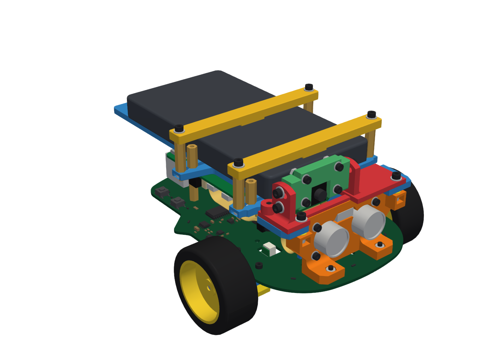

# Keel robot chassis

A 3D-printed chassis that turns a Keel R3 board into a small two-wheeled robot. The Keel board is the base plate.
The Raspberry Pi 4 mounts upside down on it. Two micro gearmotors under the board drive 47 mm wheels and a ball
caster carries the rear. An HC-SR04 ultrasonic sensor plugs into J1 at the front, a Raspberry Pi Camera Module 2 or 3
looks forward from a tilting mast, and a USB-C power bank on the top plate powers the Pi. The printed parts are 17
pieces, about 3.2 h and 83 g of PETG.

  

Assembly instructions: [`assembly.md`](assembly.md).

## Files

| Path | Contents |
|---|---|
| [`assembly.md`](assembly.md) | Step-by-step build guide |
| [`Keel_R3_robot_assembly.3mf`](Keel_R3_robot_assembly.3mf) | The assembled robot, one named object per part. For viewing in a 3D viewer or slicer, not for printing. |
| [`print/parts/`](print/parts) | One 3MF per printed part, oriented as printed. The number after `_x` is how many to print. |
| [`print/plates/`](print/plates) | The parts laid out on four plates for a 350 x 320 mm bed |
| [`images/`](images) | Renders used in the build guide |

All 3MF files are in millimetres and carry no printer or filament profile, so they open in any slicer with your own
printer settings.

The assembly file shows the printed parts, the fasteners and simplified models of the purchased parts drawn for this
project. The Keel board in it comes from [`hardware/3d/Keel_R3.step`](../hardware/3d/Keel_R3.step). The power bank
is shown at the 133 x 70 x 14 mm reference size.

## Printed parts

| ID | Part | File in `print/parts/` | Qty | Plate | Time per piece | PETG per piece |
|---|---|---|---|---|---|---|
| P01 | Front tower | `P01_front_tower_x1.3mf` | 1 | 1 | 26.9 min | 8.2 g |
| P02 | Sensor frame, left | `P02_sensor_frame_left_x1.3mf` | 1 | 1 | 3.4 min | 0.4 g |
| P02 | Sensor frame, right | `P02_sensor_frame_right_x1.3mf` | 1 | 1 | 3.5 min | 0.4 g |
| P03 | Sensor shim 0.2, 0.4, 0.6, 0.8 or 1.0 mm (only if assembly step 8 calls for it) | `P03_sensor_shim_<thickness>_x4.3mf` | 4 of one thickness | none | 0.7 to 0.8 min | 0.1 g |
| P04 | Tower shim 0.2 mm | `P04_tower_shim_0.2mm_x2.3mf` | 2 | 1 | 0.7 min | 0.1 g |
| P04 | Tower shim 0.4 mm | `P04_tower_shim_0.4mm_x2.3mf` | 2 | 1 | 0.8 min | 0.1 g |
| P05 | Camera mast | `P05_camera_mast_x1.3mf` | 1 | 1 | 24.0 min | 5.5 g |
| P06 | Camera carrier | `P06_camera_carrier_x1.3mf` | 1 | 1 | 13.1 min | 3.2 g |
| P07 | Motor bracket (left and right are the same part) | `P07_motor_bracket_x2.3mf` | 2 | 2 | 13.0 min | 1.9 g |
| P08 | Motor cap | `P08_motor_cap_x2.3mf` | 2 | 3 | 4.5 min | 1.4 g |
| P09 | Caster spacer | `P09_caster_spacer_x1.3mf` | 1 | 2 | 10.8 min | 3.6 g |
| P10 | Top plate | `P10_top_plate_x1.3mf` | 1 | 1 | 88.6 min | 45.9 g |
| P11 | Bank bridge | `P11_bank_bridge_x2.3mf` | 2 | 2 | 11.5 min | 4.9 g |
| T01 | Fit coupon (optional) | `T01_fit_coupon_x1.3mf` | 1 | 4 | 67.2 min | 28.6 g |

Times are slicer estimates with the settings below and a 0.4 mm nozzle, for one piece printed on its own. On the
plates, the 17 pieces of the robot take 192.5 min (3.2 h) and 82.6 g.

## Plates

The files in [`print/plates/`](print/plates) hold the parts in their print orientation, arranged for a 350 x 320 mm
bed with 8 mm between parts.

| File | Parts | Pieces | Time | PETG |
|---|---|---|---|---|
| `plate1_top_plate_front_camera.3mf` | P10, P01, P02 left and right, P05, P06, P04 tower shims 0.2 mm x2 and 0.4 mm x2 | 10 | 140.5 min | 63.1 g |
| `plate2_brackets_spacer_bridges.3mf` | P07 x2, P09, P11 x2 | 5 | 44.8 min | 16.7 g |
| `plate3_motor_caps.3mf` | P08 x2 | 2 | 7.2 min | 2.8 g |
| `plate4_fit_coupon.3mf` | T01 (optional) | 1 | 67.2 min | 28.6 g |

## Which files to use

| Printer | Files | How |
|---|---|---|
| Bed 350 x 320 mm or larger | `print/plates/` | Open a plate in Bambu Studio, OrcaSlicer, PrusaSlicer or Cura, select your printer and a PETG profile, apply the settings below and slice. Turn off auto-arrange and auto-orient so the parts keep their positions and orientation. |
| Smaller bed | `print/parts/` | Import the parts, add copies up to the quantity in each file name, and let the slicer arrange them over as many plates as needed. The top plate (P10) needs 97 x 182 mm of bed. |

## Print settings

| Setting | Value |
|---|---|
| Material | PETG, every part |
| Nozzle and layers | 0.4 mm nozzle, 0.20 mm layers, 0.20 mm first layer |
| Walls and infill | 4 walls, 5 top and 4 bottom layers, 40 % gyroid infill |
| Supports | Off. Every overhang is a short bridge, within 45 degrees, or the 1.2 mm ledge of a T-slot in the top plate. |
| Orientation | As in the files. Each part's bed face is chosen for its load; do not re-orient. |
| X-Y hole and contour compensation | 0. The holes, slots and nut pockets already include their clearance. |
| Elephant-foot compensation | Printer default (about 0.15 mm). The parts have 0.4 mm chamfers at the bed. |
| Build plate | Textured PEI, or a smooth plate with a thin layer of glue stick as a release agent. PETG can bond to bare smooth PEI hard enough to damage the plate or the part. |
| Enclosed printers | Open the front door or remove the top glass. At the 70 C bed temperature PETG needs, a closed chamber can clog the nozzle by heat creep. |
| Thin shims | The 0.2 mm shims are a single layer. Let the plate cool and lift them with a thin blade. |

### Fit coupon

The fit coupon is optional. It holds every hole, nut pocket and slot type used in the parts. Print it only if you
use a different nozzle, filament or hole compensation, or if a nut does not drop into its pocket by its own weight.
Seen from above with the bevelled corner at the front right, the back row has clearance holes and the second row has
hex-nut pockets. In each row the first three positions are M2 and the next three M2.5, at 0.1 mm under, at, and
0.1 mm over the size used in the parts. Test them with your screws and nuts:

- The middle size fits (screws pass freely, nuts drop in and do not turn): print the parts as they are.
- Only the larger size fits: set the slicer's X-Y hole compensation to +0.05 mm.
- The smaller size already fits: set it to -0.05 mm.

The other positions hold snug holes and a sideways hole (back row, right), lock-nut and thin-nut pockets (second row,
right), washer counterbores and a T-slot like those in the top plate (third row), and side slots for nuts (front
row).

## Purchased parts

| Item | Qty | Description |
|---|---|---|
| Keel R3 board | 1 | Assembled and tested; see [`hardware/README.md`](../hardware/README.md) |
| Raspberry Pi 4 | 1 | Model B, any memory size, with a microSD card |
| 2x20 stacking header | 1 | 2.54 mm pitch, 8.5 mm socket body, 6 mm pins; joins PI1 to the Pi's 40-pin header |
| Micro metal gearmotor | 2 | 12 x 10 mm, 110:1, 3 mm D output shaft 12 mm long, with a connector board carrying a 2-pin 1.5 mm (JST-ZH type) socket |
| Motor lead | 2 | 2-pin 1.5 mm (JST-ZH type) plug at both ends, 50 to 100 mm |
| Wheel | 2 | 47 mm over the tyre, 34 mm rim, about 20 mm wide, push-on hub for a 3 mm D shaft |
| Ball caster | 1 | 3/4 in (19 mm) steel ball, two mounting holes 15.5 mm apart, 20.9 mm from the mounting face to the bottom of the ball |
| HC-SR04 ultrasonic sensor | 1 | With a right-angle 4-pin header |
| Raspberry Pi Camera Module 2 or Camera Module 3 | 1 | Camera Module 3 with the standard lens. Both share the 25 x 24 mm board and its four holes, so the carrier takes either. |
| Camera cable | 1 | 15-way, 1.0 mm pitch flat cable, 150 mm, contacts on opposite faces at the two ends. The 200 mm cable supplied with Camera Module 3 does not fit. |
| USB-C power cable | 1 | 3 A, 90 degree side-angle plug at the Raspberry Pi end, straight plug at the bank end, about 0.3 m |
| USB-C power bank | 1 | 5 V / 3 A USB-C output, port on a short end; size range below |

## Fasteners and standoffs

Metric, M2 and M2.5 only: ISO 4762 socket head cap screws, ISO 4032 hex nuts, ISO 4035 thin nuts, ISO 10511
nylon-insert lock nuts, ISO 7089 washers, DIN 988 steel shim washers, and brass or steel hex standoffs 5.0 mm across
flats. Standoffs 5.5 mm across flats do not fit beside the stacking header.

| Item | Size | Qty | Used for |
|---|---|---|---|
| Socket head cap screw | M2 x 6 | 2 | Caster spacer to the board |
| Socket head cap screw | M2 x 8 | 10 | Sensor clamp 4, motor brackets 4, caster to its spacer 2 |
| Socket head cap screw | M2 x 10 | 8 | Camera on its carrier 4, motor caps 4; 4 more (and 4 fewer M2 x 8) with 0.8 mm or 1.0 mm sensor shims |
| Socket head cap screw | M2.5 x 6 | 7 | Top plate 4, lower Raspberry Pi standoffs 3 |
| Socket head cap screw | M2.5 x 8 | 2 | Front tower feet |
| Socket head cap screw | M2.5 x 10 | 8 | Camera pivots 2, camera tilt locks 2, bank bridges 4 |
| Socket head cap screw | M2.5 x 12 | 2 | Camera mast, rear |
| Socket head cap screw | M2.5 x 16 | 2 | Camera mast to the front tower |
| Hex nut | M2 | 6 | Camera 4, caster spacer 2 |
| Hex nut | M2.5 | 3 | Camera mast 2, Raspberry Pi front-right corner 1 |
| Thin nut | M2 | 6 | Sensor clamp 4, caster 2 |
| Thin nut | M2.5 | 10 | Power-bank clamp, in the top plate's T-slots |
| Lock nut (nylon insert) | M2 | 8 | Motor brackets 4, motor caps 4 |
| Lock nut (nylon insert) | M2.5 | 8 | Front tower feet 2, camera mast to the tower 2, camera pivots and locks 4 |
| Washer | M2 | 14 | Sensor clamp 4, camera 4, motor caps 4, caster 2 |
| Washer | M2.5 | 16 | Camera mast 4, camera pivots and locks 4, top plate 4, bank bridges 4; more for some power banks (below) |
| Steel shim washer | 3 x 6 x 0.1 mm | 6 | Camera tilt locks (up to 2 each), tower tie-in (up to 1 each side) |
| Hex standoff, female-female | M2.5 x 20 | 3 | Raspberry Pi, under the board side |
| Hex standoff, male-female, 6 mm thread | M2.5 x 8 | 4 | Raspberry Pi, between the Pi and the top plate |
| Hex standoff, male-female, 6 mm thread | M2.5 x 12 | 6 | Power-bank side stops 4 and rear stops 2 |
| Hex standoff, male-female, 6 mm thread | M2.5, length below | 4 | Power-bank bridge supports |

A few spare M2 and M2.5 nuts help: a nut in a slot is held only once its screw is in.

## Power bank

The top plate takes any power bank with a USB-C output of 5 V / 3 A whose size is in this range, with its port end
facing the rear:

| Length | Width | Thickness |
|---|---|---|
| 104 to 148.4 mm | 52.3 to 73 mm | 14 to 26 mm |

Only the four bridge-support standoffs depend on the bank. Their height, the standoff plus the washers under it,
must be the bank thickness plus 4.0 mm, within 0.25 mm. The bridges then press the bank by 0.6 mm.

| Bank thickness | Bridge-support standoffs (4) | M2.5 washers under each standoff |
|---|---|---|
| 14.0 to 14.2 mm | M2.5 x 18 | 0 |
| 14.3 to 14.7 mm | M2.5 x 18 | 1 |
| 14.8 to 15.2 mm | M2.5 x 18 | 2 |
| 15.3 to 15.7 mm | M2.5 x 18 | 3 |
| 15.8 to 16.2 mm | M2.5 x 20 | 0 |
| 16.3 to 16.7 mm | M2.5 x 20 | 1 |
| 16.8 to 17.2 mm | M2.5 x 20 | 2 |
| 17.3 to 17.7 mm | M2.5 x 20 | 3 |
| 20.8 to 21.2 mm | M2.5 x 25 | 0 |
| 21.3 to 21.7 mm | M2.5 x 25 | 1 |
| 21.8 to 22.2 mm | M2.5 x 25 | 2 |
| 22.3 to 22.7 mm | M2.5 x 25 | 3 |
| 25.8 to 26.0 mm | M2.5 x 30 | 0 |

For a thickness between these rows (17.8 to 20.7 mm or 22.8 to 25.7 mm), screw two male-female standoffs together
to reach the height, for example 18 + 5 mm for a 19 mm bank.

## Fit notes

The front tower (P01) and the camera mast (P05) are made for these dimensions of the purchased parts. Measure the
two HC-SR04 values with calipers before you print plate 1:

| Dimension | Value the parts are made for | What absorbs a difference |
|---|---|---|
| Raspberry Pi circuit board thickness | 1.4 mm | 1.4 to 1.6 mm: the tower shims (assembly step 13) |
| HC-SR04: header pin row behind the back of the sensor's circuit board, to the pin centres | 3.9 mm | 3.0 to 4.0 mm: the sensor shims (assembly step 8). With more than 4.0 mm the sensor presses on the tower before its pins stand straight in J1. |
| HC-SR04: bottom edge of the sensor's circuit board above the Keel board, header pushed fully into J1 | 8.0 mm | Lower: the screws hold the sensor at the right height and its pins sit slightly less deep in J1. More than about 0.2 mm higher: the sensor's screw holes miss the tower's holes. |

## Licence

Copyright (c) 2026 BisocM. The chassis files are hardware design files and are licensed under the CERN Open Hardware
Licence Version 2 - Permissive (CERN-OHL-P-2.0), like the rest of the hardware: see
[`LICENSE-HARDWARE`](../LICENSE-HARDWARE). The Keel board model inside `Keel_R3_robot_assembly.3mf` is derived from
[`hardware/3d/Keel_R3.step`](../hardware/3d/Keel_R3.step), whose component models keep the licences listed in
[`THIRD_PARTY_NOTICES.md`](../THIRD_PARTY_NOTICES.md).
