# Building the Keel robot

This guide takes you from the printed parts and the purchased parts to a running robot. The parts lists, print
settings and power-bank table are in [`README.md`](README.md).

  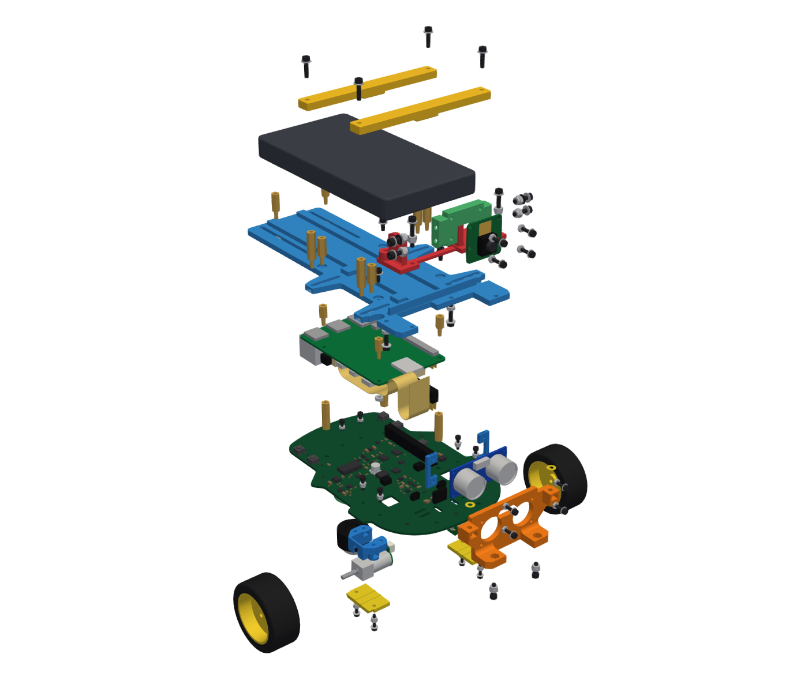

Directions used in this guide:

- **Front** is the end with the ultrasonic sensor. **Left** and **right** are as seen from behind the robot, looking
  forward.
- The **top side** of the Keel board is the side with the 40-pin socket PI1. The Raspberry Pi mounts upside down
  over it, and the motors, wheels and caster are on the underside.

In the step pictures, the left view shows the robot after the step and the right view shows the parts of the step
moved apart along the way they go on. Parts added in the step are in colour: printed parts orange, screws, nuts,
washers and standoffs blue, purchased parts in their own colours (bare metal dark grey). Parts fitted in earlier
steps are light grey.

## Contents

- [Before you start](#before-you-start)
- [Tools](#tools)
- [Rules for every joint](#rules-for-every-joint)
- [Under the board](#under-the-board): steps 1 to 5
- [Board top side up](#board-top-side-up): steps 6 to 10
- [Top plate, camera and power](#top-plate-camera-and-power): steps 11 to 16
- [Finishing](#finishing)
- [Shim choices](#shim-choices)
- [Service access](#service-access)

## Before you start

1. Print the parts ([`README.md`](README.md#printed-parts)). Check the two HC-SR04 dimensions in the
   [fit notes](README.md#fit-notes) before you print plate 1.
2. The Keel board must be assembled and brought up, with its safety controller programmed: see
   [`hardware/README.md`](../hardware/README.md) and the bring-up procedure in
   [`hardware/docs/bringup.md`](../hardware/docs/bringup.md), whose section 4 programs the safety controller.
3. Prepare the Raspberry Pi's microSD card with the robot's operating system, 64-bit Ubuntu 26.10 for Raspberry Pi
   (for example with Raspberry Pi Imager), and insert it into the Pi. The card used for the bring-up can be this
   card. After assembly the card slot is reached from the front left.
4. Insulate the underside of the board ([`bringup.md`](../hardware/docs/bringup.md#7-before-driving-on-floors),
   section 7): cover the 28 test pads and the PI1 and J1 solder joints with polyimide tape, clear of the screw
   holes.
5. Check the camera cable. It must be 150 mm long, 15-way, 1.0 mm pitch, with its contacts on opposite faces at
   the two ends: lay it flat and check that the stiffeners at the two ends are on opposite faces. The 200 mm cable
   supplied with Camera Module 3 has both stiffeners on the same face and does not fit the route.
6. Choose the power bank, measure its thickness with calipers and get the four bridge-support standoffs and any
   washers it needs ([power bank table](README.md#power-bank)).

## Tools

| Tool | Used for |
|---|---|
| Hex key 1.5 mm | Every M2 socket head screw |
| Hex key 2.0 mm, and a short L-key with a short arm of about 15 mm | Every M2.5 socket head screw; the short key for the two camera-mast screws driven up from under the top plate (step 14) |
| Nut drivers or thin spanners 4.0 mm and 5.0 mm | M2 and M2.5 nuts; the 5.0 mm driver also turns and holds the hex standoffs |
| Tweezers | Nuts into slots, thin nuts into the caster |
| Feeler gauges 0.1 to 1.0 mm | Shim choices (steps 8, 13 and 14) |
| Calipers | Power bank and HC-SR04 checks |
| Polyimide tape | Insulating the board's underside |
| 3 mm hex key or 3 mm drill shank | Gauge for the wheel position (step 5) |
| Torque screwdriver (optional) | 0.10 N m for M2 and 0.20 N m for M2.5 screws into printed parts |

## Rules for every joint

- **Nut first.** Put each nut into its printed slot or pocket before the part goes on. The slots have no snap lip:
  the screw holds the nut. Where a slot faces down, hold the nut with a finger until the screw has caught.
- **Washers** go under every screw head that bears on a printed part. Screw heads on the Keel board take no washer.
- **Torque** into printed parts: M2 0.10 N m, M2.5 0.20 N m. Lock nuts are tightened to the same values. Exceptions:
  - camera tilt-lock screws: 0.10 N m, because their washers bridge a slot;
  - camera pivot screws: snug only, so the camera carrier turns with light friction;
  - the ten power-bank clamp standoffs that thread into the top plate's T-slot nuts: fingertip torque, about
    0.02 N m. Turn the 5.0 mm nut driver by its shaft between thumb and finger until the standoff stops.

## Under the board

Lay the Keel board top side down on a soft mat. The underside, facing up, takes the caster, the motor brackets and
the motors. In steps 2 and 3, hold the part on the underside over its holes, then tilt the board up to drive the
screws from the top side.

### Step 1. Caster on the caster spacer (on the bench)

You need: P09 caster spacer, ball caster, 2 x M2 thin nut, 2 x M2 x 8 screw, 2 x M2 washer.

1. Put an M2 thin nut into each of the two cavities in the caster body beside its mounting holes (tweezers).
2. Hold the caster against the flat face of the spacer, with its holes under the two counterbored holes.
3. From the counterbored face, drive the two M2 x 8 screws with washers through the spacer into the nuts.

This joint can only be reached from the counterbored face, which goes against the board, so it is made before the
spacer goes on.

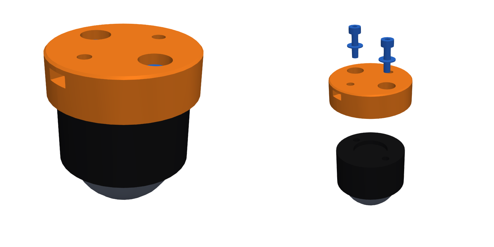

### Step 2. Caster spacer to the board

You need: the caster unit from step 1, 2 x M2 hex nut, 2 x M2 x 6 screw.

1. Slide an M2 hex nut into each of the two side slots of the spacer. The slots open to the left and right.
2. Hold the spacer, counterbored face against the board, over the two holes at the rear centre of the board.
3. Drive the two M2 x 6 screws from the top side into the nuts, no washers.

These two holes lie under the Raspberry Pi's USB ports, so this step comes before the Pi goes on.

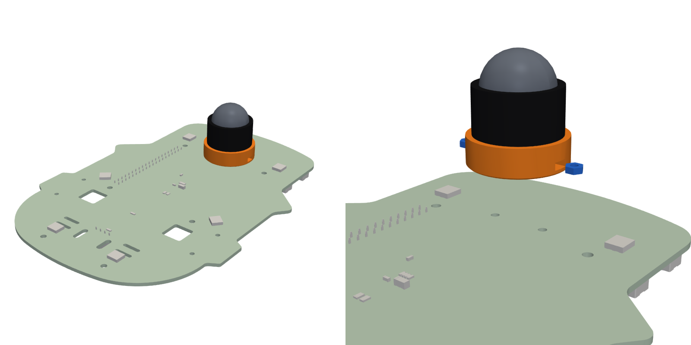

### Step 3. Motor brackets

You need: 2 x P07 motor bracket, 4 x M2 lock nut, 4 x M2 x 8 screw.

1. Push an M2 lock nut into each of the two ear slots of both brackets, from the inside of the motor channel.
2. Hold a bracket over the two holes beside a motor window. The two brackets are the same part: the right one is
   the left one turned round.
3. Drive two M2 x 8 screws from the top side into the lock nuts, no washers. Repeat on the other side.

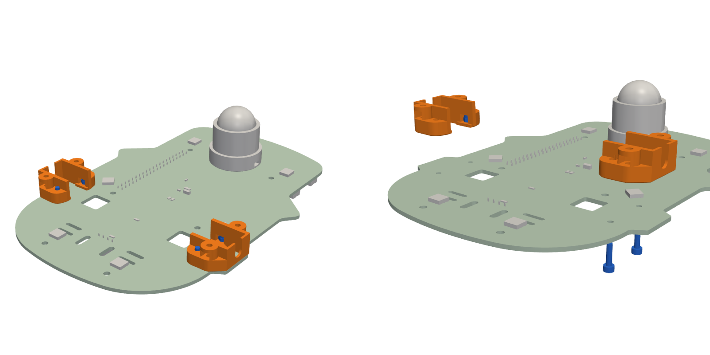

### Step 4. Motors and motor caps

You need: 2 x gearmotor, 2 x P08 motor cap, 4 x M2 lock nut, 4 x M2 x 10 screw, 4 x M2 washer.

1. Push an M2 lock nut into each of the two cap slots of each bracket. They open to the front and to the rear.
2. Hold a motor with its shaft pointing outward and its gearbox face against the inside of the bracket's end wall.
   Lower it straight into the channel: the shaft passes through the U-slot in the end wall, the round motor body
   passes beside the two small keys in the corners of the channel, and the motor's connector board enters the
   window in the Keel board. The motor is in place when its flat face lies on the board.
3. Put a motor cap on the bracket, ribs toward the motor, and fasten it with two M2 x 10 screws with washers into
   the lock nuts. The ribs press the motor by 0.2 mm; the end wall, the keys, the board and the cap hold it.
4. Repeat for the other motor.

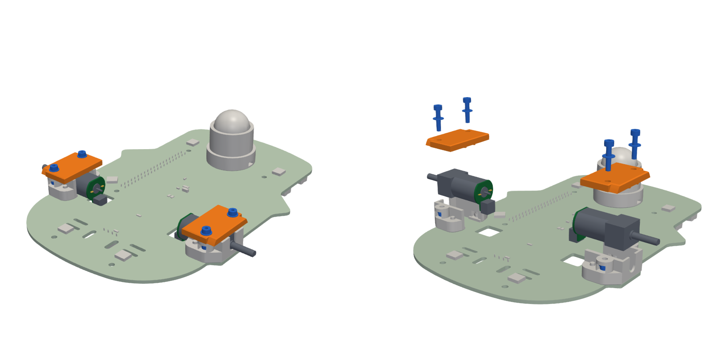

### Step 5. Wheels

You need: 2 x wheel.

1. Turn the wheel until the flat in its hub lines up with the flat on the motor shaft.
2. Push the wheel on until its inner face is 3 mm from the edge of the board. Use a 3 mm hex key or drill shank laid
   between the board edge and the tyre as a gauge. The bracket takes the push force.

At this position the wheel clears the motor cap by 1.5 mm and its hub holds about 7 mm of the 12 mm shaft.

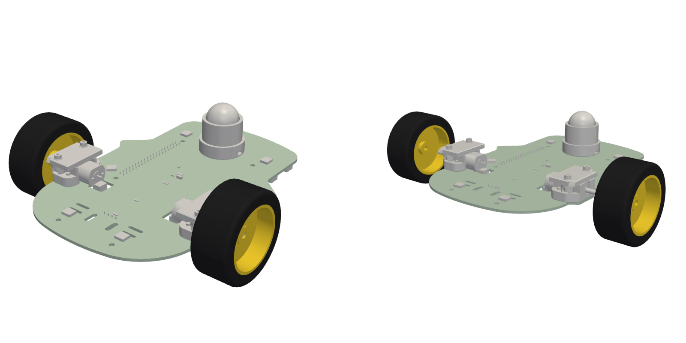

## Board top side up

Turn the robot over so it stands on its wheels and caster.

### Step 6. Motor leads

You need: 2 x motor lead.

1. Plug a lead into the connector of each motor, which shows through the motor window.
2. Plug the other end into J2 for the left motor and J3 for the right motor. Lay the leads flat on the board.

J2 and J3 are under the Raspberry Pi. Connect them before step 10.

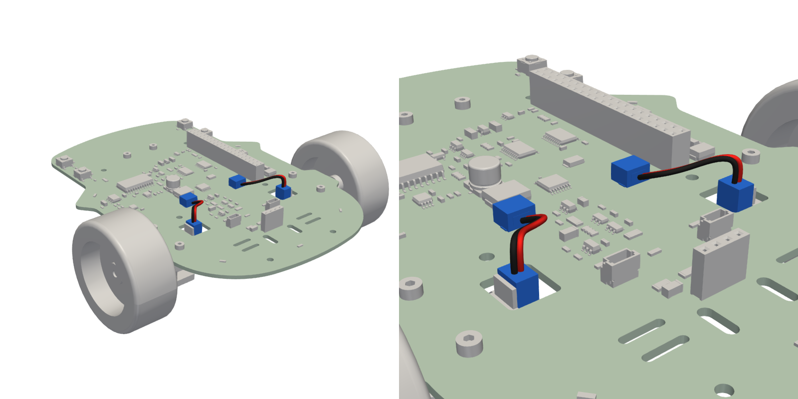

### Step 7. Lower Raspberry Pi standoffs

You need: 3 x M2.5 x 20 female-female standoff, 3 x M2.5 x 6 screw.

1. Fit a standoff to each of three Raspberry Pi mounting holes (marked M2.5 on the board): rear left, rear right and
   front left. Fasten each with an M2.5 x 6 screw from the underside, no washer, and tighten firmly.
2. Turn the two standoffs beside the 40-pin socket so that a flat side, not a corner, faces the socket. With a
   corner facing it, the stacking header does not fit.
3. Leave the front-right hole empty. The camera cable passes there.

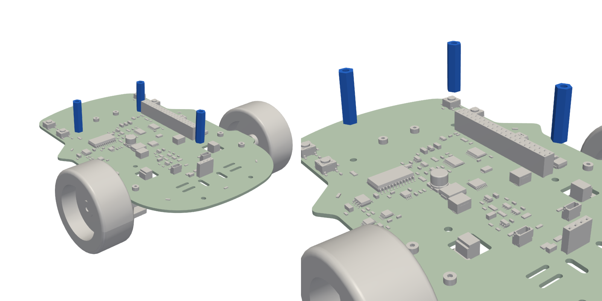

### Step 8. Front sensor unit

You need: P01 front tower, 2 x P02 sensor frame (left and right), HC-SR04, 2 x M2.5 lock nut, 4 x M2 thin nut,
4 x M2 x 8 screw (M2 x 10 with 0.8 mm or 1.0 mm sensor shims), 4 x M2 washer, 2 x M2.5 x 8 screw, P03 sensor shims
if needed.

The sensor's transducers pass through closed windows in the tower, and its pins enter J1 straight down. The sensor
therefore cannot be plugged into J1, or pulled out, while the tower sits in its slots: the tower, the frames and the
sensor always go on and come off as one unit.

1. On the bench, with the tower standing upright: push an M2.5 lock nut into each of the two pockets in the top of
   the tower's feet. Keep the tower upright from here on so the nuts stay in.
2. Push an M2 thin nut into each of the four pads of the two sensor frames. The slots open at the top edge of each
   pad, so the nuts stay in by their weight.
3. Sensor shims: hold the sensor in the tower windows and lower both together onto the board, without screws, so the
   pins enter J1 and the tower's tabs enter the two slots at the front of the board. With the pins standing straight
   in J1, slide feeler gauges between the sensor's circuit board and the tower's rear face. Choose the sensor shims
   from the gap ([shim choices](#sensor-shims)). Lift the unit off again.
4. Hold the HC-SR04 against the tower's rear face with the transducers in the windows, and the two sensor frames
   behind its corners. Start the four M2 screws with washers from the front of the tower, through the tower, any
   sensor shims (between the tower and the sensor), the sensor and the frame into the thin nuts. Two turns only, so
   the sensor can still move about 0.2 mm.
5. Lower the unit straight down onto the board: the header pins go into J1, transducers facing forward, and the
   tower's tabs into the front slots at the same time. Press until the tower's feet sit on the board.
6. Start the two M2.5 x 8 screws from the underside, through the holes under the tower's feet, into the lock nuts.
   Finger tight only.
7. Tighten the four sensor screws to 0.10 N m. J1 has placed the sensor; the screws clamp it to the tower.
8. Tighten the two foot screws to 0.20 N m. The sensor's pins carry no load.

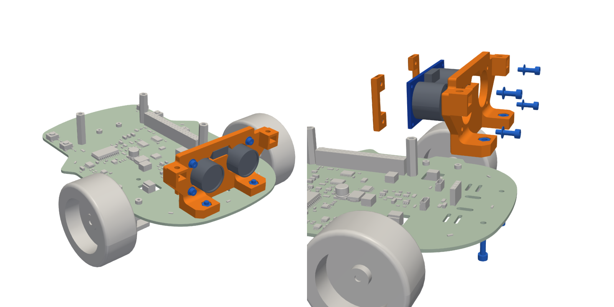

### Step 9. Prepare the Raspberry Pi (on the bench)

You need: Raspberry Pi 4, camera cable, 1 x M2.5 x 8 male-female standoff, 1 x M2.5 hex nut.

1. Find the Pi mounting hole next to the USB-C power socket. Push the male thread of the standoff through this hole
   from the solder side (the side without the USB and Ethernet sockets), and screw the M2.5 nut onto it from the
   component side. Use the 5.0 mm driver on both. This corner of the Pi is clamped here and nowhere else.
2. Open the latch of the Pi's camera connector (between the micro-HDMI ports and the audio jack). Insert one end of
   the camera cable with its contacts facing the micro-HDMI ports and its stiffener toward the USB and Ethernet
   sockets. Close the latch.

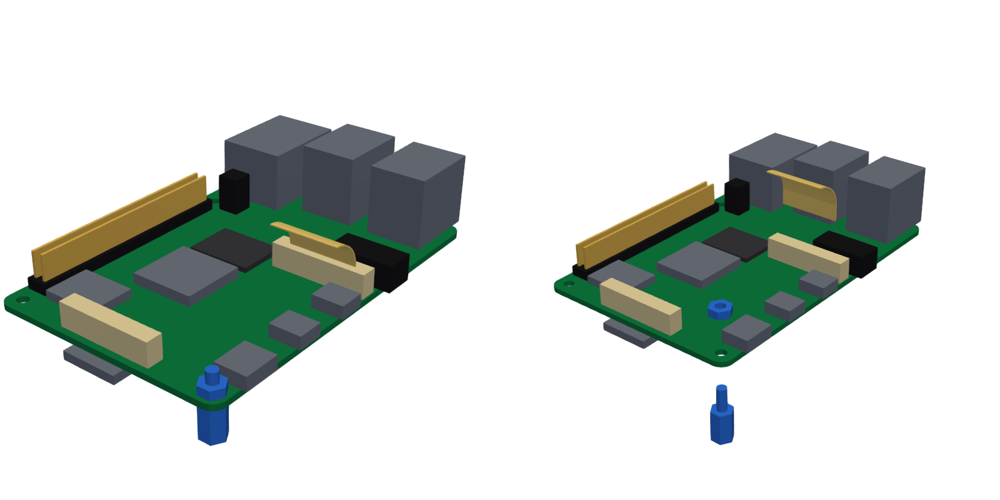

### Step 10. Raspberry Pi onto the board

You need: the Pi from step 9, 2x20 stacking header, 3 x M2.5 x 8 male-female standoff.

1. Push the stacking header into PI1.
2. Hold the Pi component side down, USB and Ethernet sockets to the rear. Lead the camera cable forward under the
   Pi, flat, just inside the empty front-right standoff position, so that it comes out in front of the Pi.
3. Lower the Pi so its 40-pin header goes onto the stacking header, and press it home.
4. Push the male threads of the three remaining standoffs through the Pi's other three mounting holes and screw them
   into the lower standoffs with the 5.0 mm driver.

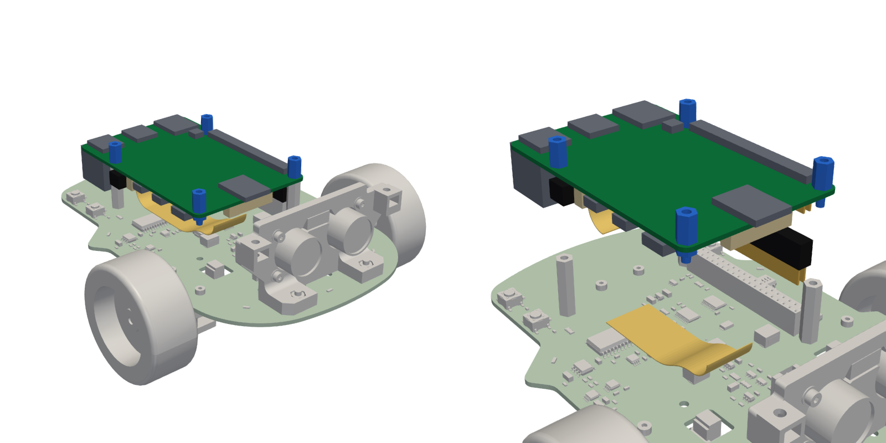

## Top plate, camera and power

### Step 11. Top plate

You need: P10 top plate, 10 x M2.5 thin nut, the four bridge-support standoffs for your power bank and their washers,
6 x M2.5 x 12 male-female standoff, 4 x M2.5 x 6 screw, 4 x M2.5 washer.

1. On the bench, slide the T-slot nuts into the plate. At each of the four ear slots (front and rear, left and
   right), slide in two M2.5 thin nuts from the outer edge, flats against the channel walls. The first nut in is for
   a side stop, the second for a bridge support. Slide one M2.5 thin nut into each of the two rear slots from the
   rear edge of the plate. The nuts stay in the closed channels.
2. Bridge supports: put the washers your power bank needs (none for most banks, see the
   [power bank table](README.md#power-bank)) on the plate over the outer end of each ear slot. Thread a
   bridge-support standoff through them onto the outer nut, at the outer end of the slot, and turn it on with
   fingertip torque.
3. Stops: thread the four side-stop and the two rear-stop M2.5 x 12 standoffs loosely onto their nuts. They are slid
   against the power bank in step 15.
4. Set the plate on the four upper standoffs over the Pi, leading the free end of the camera cable up through the
   camera notch at the front of the plate. Fasten the plate with four M2.5 x 6 screws with washers.

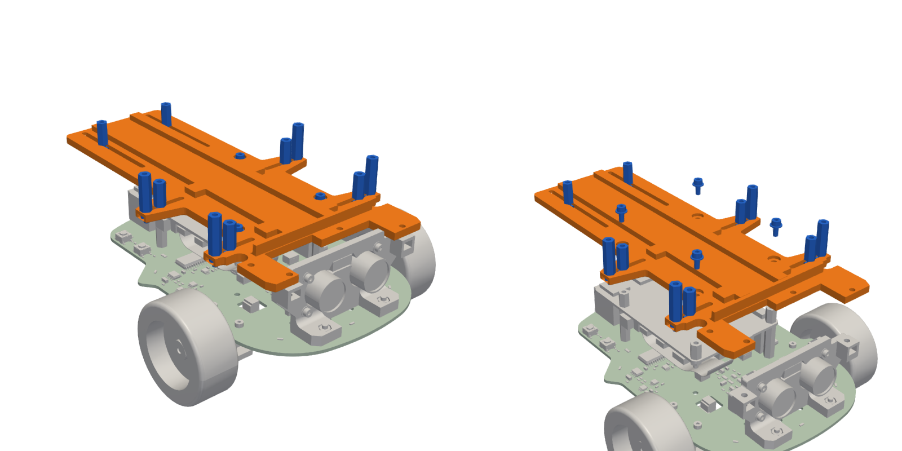

### Step 12. Camera cable slack

The camera cable runs free, without a holder. Arrange it so that its spare length forms a soft S in front of the Pi:
a loop down near the board and a loop up under the top plate, with its free end standing up through the camera
notch. Do not fold or crease it. The picture is a cut through the robot along the cable.

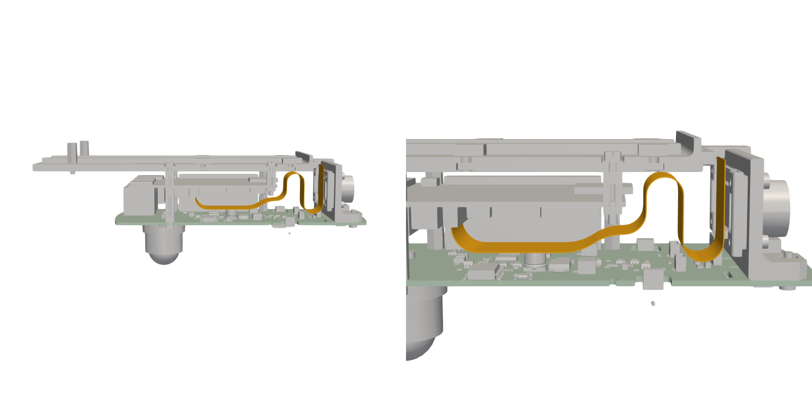

### Step 13. Tower shims

You need: the P04 tower shims (0.2 mm and 0.4 mm), steel shim washers as needed, 2 x M2.5 lock nut.

1. At each side, slide feeler gauges into the gap between the top of the tower's tie-in tab and the underside of the
   top plate. The thickest gauge that slides in is the gap.
2. For each side, choose the shims from the gap ([shim choices](#tower-shims)) and slide them into the gap from the
   front with tweezers, centred on the hole.
3. Push an M2.5 lock nut into the nut slot of each tab. The slots open forward, at the front face of each tab.

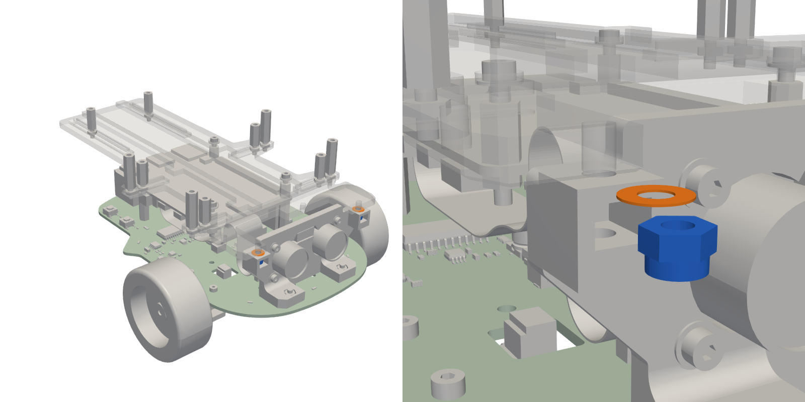

### Step 14. Camera

You need: P05 camera mast, P06 camera carrier, Camera Module 2 or 3, 4 x M2 x 10 screw, 4 x M2 washer, 4 x M2 hex nut,
4 x M2.5 x 10 screw, 4 x M2.5 washer, 4 x M2.5 lock nut, steel shim washers as needed, 2 x M2.5 hex nut,
2 x M2.5 x 16 screw, 2 x M2.5 x 12 screw, 4 more M2.5 washers.

1. On the bench, fasten the camera to the front of the carrier with four M2 x 10 screws with washers from the front
   and M2 hex nuts on the pads at the back of the camera.
2. Put the carrier between the two cheeks of the mast. Fit a pivot screw on each side: M2.5 x 10 with a washer,
   through the cheek and the carrier, into a lock nut. Tighten only until snug: the carrier must turn with light
   friction.
3. Tilt-lock shims: on each side, measure the gap between the carrier's flange and the cheek beside the curved slot
   with feeler gauges, and choose the steel shim washers ([shim choices](#camera-tilt-lock-shims)).
4. Fit a tilt-lock screw on each side, loose: M2.5 x 10 with a washer, through the curved slot, the shims (between
   the flange and the cheek) and the flange, into a lock nut.
5. Put an M2.5 hex nut into each of the mast's two rear joints: on the left into the pocket that opens upward, on the
   right into the side slot that opens to the rear.
6. Set the mast on the top plate's front horns, with the camera level. Drive the two M2.5 x 16 screws with washers
   down through the mast, the plate, the tower shims and the tower tabs into the lock nuts from step 13. The right
   screw can only be reached with the camera tilted down 10 degrees or less: drive it with the camera level.
7. Drive the two M2.5 x 12 screws with washers up from under the plate into the rear nuts, using the short L-key
   (short arm up, long arm sideways).
8. Open the latch of the camera's connector and insert the free end of the camera cable with its contacts facing the
   camera's circuit board and its stiffener facing the rear. Close the latch. At both ends the cable's contacts face
   the front of the robot.
9. Set the tilt and tighten both tilt-lock screws to 0.10 N m. The ends of the curved slots stop the tilt at 5
   degrees up and 25 degrees down. Before you use the full upward tilt, check that the camera cable does not touch
   the sensor frame behind the HC-SR04.

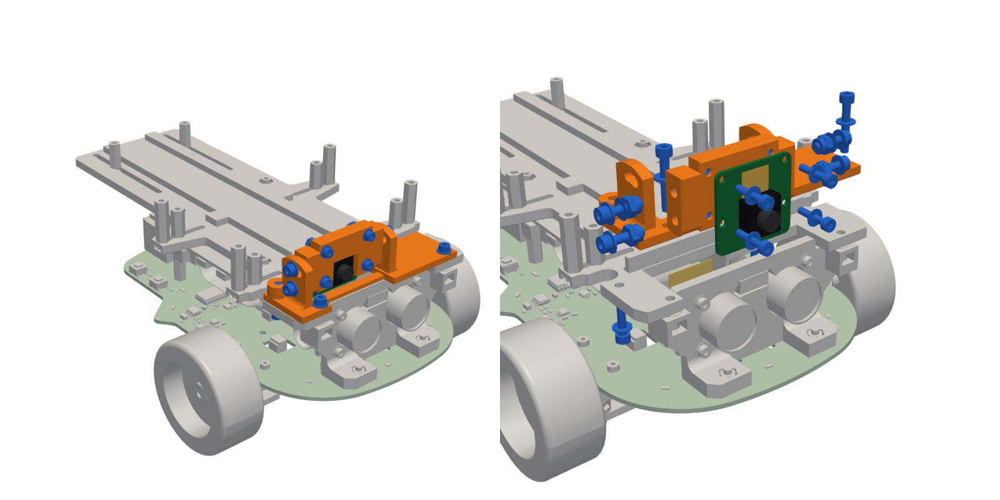

### Step 15. Power bank

You need: the power bank, 2 x P11 bank bridge, 4 x M2.5 x 10 screw, 4 x M2.5 washer.

1. Set the bank on the pads of the top plate, port end to the rear, its front face against the plate's front lip.
2. Slide the four side stops against the bank's sides and the two rear stops against its rear face, and turn each
   one on with fingertip torque.
3. Lay each bridge across the bank, pad down, onto its two bridge supports. Fasten each end with an M2.5 x 10 screw
   with a washer into the support, tightened to 0.20 N m. While tightening, hold the support's hex with the 5.0 mm
   driver so the screw does not turn the support further onto its nut.

The pad presses the bank by 0.6 mm and the bridge flexes. The support height sets the clamp, so tightening harder
does not squeeze the bank more.

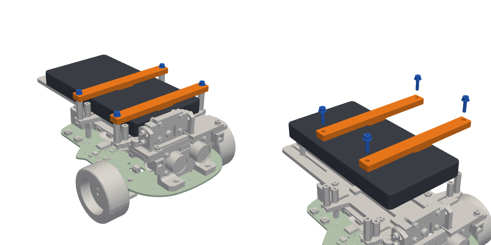

### Step 16. Power cable

You need: the USB-C power cable.

1. Plug the side-angle end into the Pi's USB-C socket on the right side of the robot, with the cable leaving toward
   the rear.
2. Lead the cable rearward along the right side, behind the right wheel, around the rear edge of the top plate and
   up behind the bank, and plug it into the bank's port. The cable runs free.

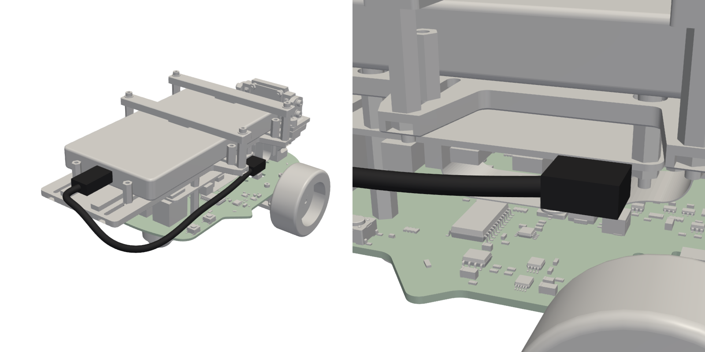

## Finishing

1. **Safety controller.** It was programmed during the bring-up. To program it again, for example with a newer
   image, use the programming switch SW5, reached from the left side of the robot:
   [`firmware/safety-mcu/README.md`](../firmware/safety-mcu/README.md).
2. **Software.** Install the host software on the Pi as described in the
   [installation section of the main README](../README.md#building-and-installing).
3. **Re-tighten** every screw into a printed part after the first 10 hours of driving, to the same torque. PETG
   creeps a little under load.

  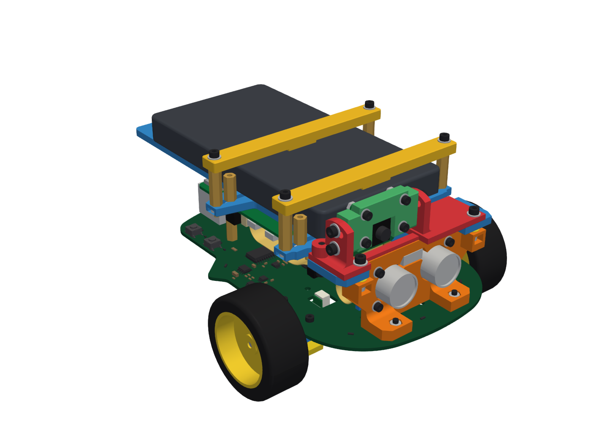

## Shim choices

Feeler gauges measure a gap: the thickest gauge that slides in without force is the gap.

### Sensor shims

Measured in step 8: the gap between the HC-SR04's circuit board and the tower's rear face, with the pins standing
straight in J1. Fit four shims of one thickness, one on each sensor screw between the tower and the sensor.

| Gap | Sensor shims (`P03_sensor_shim_*`) | Sensor screws |
|---|---|---|
| Less than 0.2 mm | None | M2 x 8 |
| 0.2 to 0.39 mm | 4 x 0.2 mm | M2 x 8 |
| 0.4 to 0.59 mm | 4 x 0.4 mm | M2 x 8 |
| 0.6 to 0.79 mm | 4 x 0.6 mm | M2 x 8 |
| 0.8 to 0.99 mm | 4 x 0.8 mm | M2 x 10 |
| 1.0 mm or more | 4 x 1.0 mm | M2 x 10 |

If the sensor touches the tower before its pins stand straight, its pin row is further back than the parts allow
(see the [fit notes](README.md#fit-notes)).

### Tower shims

Measured in step 13 on each side: the gap between the tower's tie-in tab and the underside of the top plate. Use the
printed tower shims and at most one steel 0.1 mm shim washer, so that less than 0.1 mm of gap remains.

| Gap | Shims on that side |
|---|---|
| Less than 0.1 mm | None |
| 0.1 to 0.19 mm | 1 steel 0.1 mm |
| 0.2 to 0.29 mm | 0.2 mm |
| 0.3 to 0.39 mm | 0.2 mm + 1 steel 0.1 mm |
| 0.4 to 0.49 mm | 0.4 mm |
| 0.5 to 0.59 mm | 0.4 mm + 1 steel 0.1 mm |
| 0.6 to 0.69 mm | 0.2 mm + 0.4 mm |
| 0.7 mm or more | 0.2 mm + 0.4 mm + 1 steel 0.1 mm |

The usual gap is about 0.3 mm: one 0.2 mm shim and one steel shim per side.

### Camera tilt-lock shims

Measured in step 14 on each side: the gap between the camera carrier's flange and the mast's cheek, beside the curved
slot. Fit one 0.1 mm steel shim washer per full 0.1 mm of gap: none below 0.1 mm, one for 0.1 to 0.19 mm, two for
0.2 mm or more. Without the shims, tightening the lock bends the cheek across its print layers by the whole gap.

## Service access

| Task | Access |
|---|---|
| microSD card | From the front left |
| USB-A and Ethernet | From the rear |
| USB-C power | From the right (side-angle plug) |
| Micro-HDMI ports, audio jack | From the right |
| Buttons SW1 to SW4 | From the sides: SW1 and SW2 on the left, SW3 and SW4 on the right |
| Programming switch SW5 | From the left side |
| Camera tilt | Loosen the two tilt-lock screws on the sides of the mast, set the tilt, tighten to 0.10 N m |
| Power bank | Remove the two bridges (two screws each) and lift the bank out. For a bank of another size, fit its bridge supports and washers ([power bank table](README.md#power-bank)), slide the stops against it and refit the bridges (step 15). |
| Motor | Pull the wheel straight off the shaft, remove the two cap screws from below and lower the motor straight out of the channel. The bracket stays on the board; its front screws can be reached from above through the two notches in the top plate. |
| Caster | The Raspberry Pi must come off first: the spacer screws are under its USB ports. |
| HC-SR04 | The sensor comes off together with the tower (step 8), and the tower's tabs sit under the top plate, so the top plate comes off first: (1) remove the bridges and the power bank; (2) unplug the power cable from the Pi; (3) unplug the camera cable at the camera; (4) remove the camera mast with the camera (two tie-in screws from above, two rear screws from below) and keep the tower shims of each side apart; (5) remove the four plate screws and lift the plate off with its standoffs, leading the camera cable down through the camera notch; (6) remove the two foot screws from below; (7) lift the tower, frames and sensor straight up together, about 6 mm, until the pins leave J1; (8) on the bench, remove the four sensor screws. Refit with step 8, then steps 11 to 16. |
