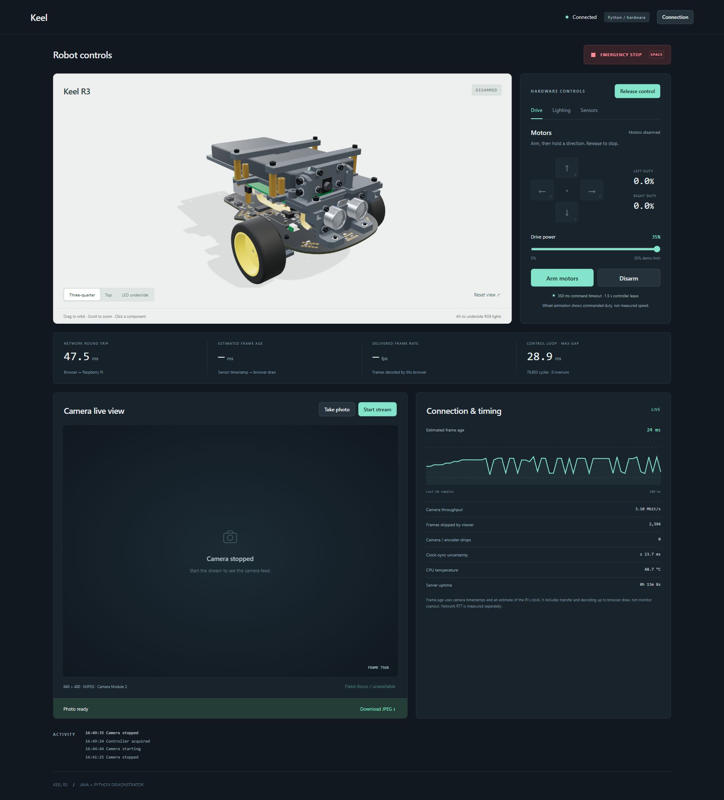

# Keel demonstrator — Java and Python

Two independent Raspberry Pi servers use their respective Keel bindings and serve
one shared browser dashboard. Open the Pi's address on your PC; the browser needs
no installation or internet connection. Three.js and the robot model are bundled.

<p align="center">
  <a href="images/ui-overview.jpg"></a><br>
  <sub>Shared Java/Python dashboard, shown with Python connected to the robot and motors disarmed.</sub>
</p>

The dashboard provides:

- An orbitable model of the actual Keel R3 assembly. Click wheels, RGB lights,
  buttons, camera or ultrasonic sensor to reach the corresponding controls.
- Six independently controlled RGB LEDs and four button indicator LEDs.
- Explicit motor arming, hold-to-drive controls (W/A/S/D), a 35% duty limit,
  disarm and a latched emergency stop (Space). Wheel animation represents commanded
  duty, not measured speed; the robot has no wheel encoders.
- Ultrasonic measurements and live physical button state.
- 640×480 MJPEG live view, full-resolution JPEG photos and autofocus when supported.
  Camera Module 2 is fixed-focus. Taking a photo briefly pauses and resumes streaming.
- Network RTT, estimated frame age, actual browser delivery FPS, throughput,
  frame skips, camera drops, control-loop timing and available CPU temperature.

## Build on the PC

Requires Node 22.12+ (or 20.19+), Python 3.11+, and JDK 25. From the repository root:

```sh
npm --prefix software/demonstrator/web ci
npm --prefix software/demonstrator/web run test
npm --prefix software/demonstrator/web run build
python software/demonstrator/java/build.py --test
python -m unittest discover -s software/demonstrator/python/tests -v
python software/demonstrator/tools/package.py
```

The archive includes both implementations, binding sources, the runnable Java jar,
and the built offline dashboard. The model is already exported. To regenerate it
after editing the studio scene, run `tools/export_model.py` in Blender; see that
script's instructions. Model geometry remains in metres, with named wheel pivots
and LED emitters for interaction.

## Upload and start on the Pi

The Pi needs `libkeel1`, `libkeel-camera1`, Python 3.11+ and JDK 25. Its account needs
the `keel` and `video` groups and the real-time limits from
[the host-library deployment guide](../libkeel/docs/deploy.md). `keel-doctor` and
`keel-camera list` check this. The included Python binding source is a fallback;
an installed compatible binding takes priority.

```sh
scp software/demonstrator/build/keel-demonstrator.tar.gz bisocm@192.168.4.160:~/
ssh bisocm@192.168.4.160
mkdir -p ~/keel-demonstrator
tar -xzf ~/keel-demonstrator.tar.gz -C ~/keel-demonstrator
cd ~/keel-demonstrator
./demo use python
./demo token
```

Open **http://192.168.4.160:8787** for Python or **http://192.168.4.160:8788** for
Java. Enter the access token, then choose **Take control**. One browser owns the
controls at a time. Other authenticated browsers may observe or emergency-stop.

Only one server can own the physical board/camera. `./demo use python` starts
Python in hardware mode and Java in clearly labelled mock mode. To switch:

```sh
./demo use java     # Java owns hardware; Python becomes mock
./demo mock         # Both are synthetic; no physical hardware used
./demo status
./demo stop         # Gracefully stop both servers
```

The manager starts detached processes that survive SSH disconnect. It does not
configure startup at boot. The selected hardware server permits explicit browser
arming but never arms itself. First driving tests should use a stand with the
wheels clear. To serve real sensors/LEDs with arming entirely disabled, start an
individual server without `--allow-motion` as below.

Logs, owned process IDs and the access token are under
`software/demonstrator/.run/` on the Pi. The token is generated there with mode
0600 and never committed, embedded in the frontend or included in URL parameters.
The manager only stops processes whose `/proc` command line matches its own server
paths. Stop both servers before replacing a deployed version.

## Run either implementation directly

From the repository root (native mode requires Linux):

```sh
python software/demonstrator/python/keel_demo.py --mode mock
java --enable-native-access=ALL-UNNAMED -Djava.awt.headless=true \
  -jar software/demonstrator/java/build/keel-demo.jar \
  --mode mock --web-root software/demonstrator/web/dist
```

Use `--mode hardware --host 0.0.0.0` on the Pi, adding `--allow-motion` to allow
deliberate arming. Both accept `--token-file`, `--port` and `--web-root`. Python's
default port is 8787, Java's is 8788. `--mode simulator` runs the native board
simulator; the camera can still be real. `--mode mock` is fully synthetic and
requires no native libraries. Hardware failure never silently falls back to mock.

The HTTP server is intended for a trusted local network. Authentication is a bearer
token, without TLS. For an untrusted network, bind to loopback and use an SSH tunnel:

```sh
ssh -L 8787:127.0.0.1:8787 bisocm@192.168.4.160
```

## Timing and safety behaviour

A dedicated board control loop runs independently of HTTP and camera work. Motor
intent expires after **350 ms**, even if other requests or heartbeats continue.
The controller lease expires after **1500 ms** without its heartbeat. Expiry,
browser focus loss, shutdown or an explicit stop clears motion and disarms. The
native MCU/watchdog protections remain in force. The browser sends fresh drive
intent every 100 ms only while a direction is held.

Sequence numbers reject reordered motion requests. Safety stops always execute,
including when overtaken by a newer heartbeat. A stop from another browser revokes
the owner's lease. Queued actions are checked again against current ownership,
deadline and stop generation before native execution. Clearing a fault does not
rearm or restore a prior drive command.

Camera frame age uses sensor start-of-exposure `CLOCK_MONOTONIC` timestamps. Python
uses the same clock; Java explicitly bridges it to its server clock with
`clock_gettime`. The browser estimates its offset with low-RTT ping exchanges.
The displayed estimate includes capture/encoding/transfer/decode up to the browser
draw, **not monitor scanout**; synchronization uncertainty is reported separately.
When only server-receipt timing exists, the UI says so and excludes capture delay.
Stalled video is marked stale, with FPS/throughput cleared and displayed-frame age
advancing. Slow viewers skip frames instead of creating a growing queue.

Tests exercise authentication, origin/body validation, competing controllers,
stale command ordering, queued arming cancellation, motor and owner deadlines,
emergency-stop latching and camera/photo lifecycle. Native integration was checked
on the Raspberry Pi without arming or driving physical motors. Real motor movement
is intentionally left to the operator's supervised test.

See [API.md](API.md), [Python implementation](python/README.md) and
[Java implementation](java/README.md) for the protocol and language-specific details.

## Licences

Application code: MIT. The browser model derives from the repository's chassis and
board designs; see [LICENSE-HARDWARE](../../LICENSE-HARDWARE) and
[THIRD_PARTY_NOTICES.md](../../THIRD_PARTY_NOTICES.md). Three.js is MIT licensed;
its notice is served in `THIRD-PARTY.txt` with the offline bundle.
